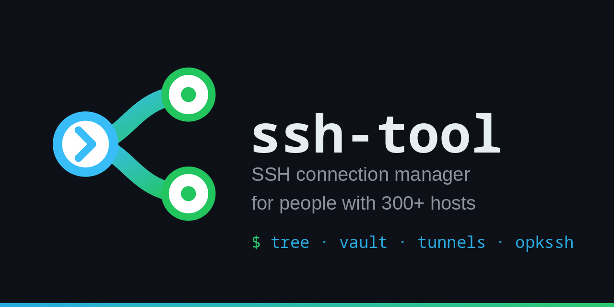

# ssh-tool

Daily-driver SSH manager for sysadmins with 300+ hosts: folder-
inherited tree, encrypted vault, multi-tab split-pane terminal,
native multi-window, SOCKS5 forwards, batch exec, RDM import.

Built on Wails v3 + Svelte 5 + Go. Single binary, cross-
platform: Windows, Linux and Android releases; macOS runs from a
build of your own (see below).

> Looking for a longer pitch? See [`docs/APP_DESCRIPTION.md`](docs/APP_DESCRIPTION.md).

## Highlights

- **Connection tree** with folder-level inherited settings, tags,
  multi-select batch editor.
- **Encrypted credential vault** - Argon2id + XChaCha20-Poly1305,
  file-only persistence with an optional machine-bound auto-unlock
  sidecar (no OS keychain), idle auto-lock,
  password strength meter.
- **Multi-window, multi-tab, multi-pane** terminal with native
  detach / redock and broadcast input across windows.
- **Workspaces** - named tab bundles you switch between with one
  click; tabs carry group chips.
- **Dynamic inventory** - auto-populated folders from Proxmox VE,
  Hetzner Cloud, DigitalOcean, Linode, Vultr, Scaleway, AWS EC2 and
  Ansible static inventory, with tag/label filters, hide-stopped,
  live load bars + Raw payload in the detail pane.
- **Power tools** - live tcpdump panel (smart sudo), HTTP/SOAP
  request modal over SOCKS5, parallel batch command exec across a
  multi-selection, snippet library (Ctrl+Shift+P), markdown notes.
- **Share a session** - to a plain web browser (a colleague watches,
  or types in with your approval; encrypted, per-guest word-code
  confirmation, no cloud relay) or to an external LLM over MCP.
- **Userspace VPN profiles** - WireGuard built in; NetBird,
  Tailscale, OpenConnect (Cisco AnyConnect, Fortinet, F5,
  GlobalProtect, Pulse), OpenVPN and Check Point as optional plugins from
  [ssh-tool-plugins](https://github.com/fpenezic/ssh-tool-plugins). No
  TUN adapter or admin rights; several gateways at once.
- **External secrets and one-time codes** - KeePass, Vaultwarden /
  Bitwarden and Infisical read at connect time; a TOTP from a Bitwarden
  or KeePass item answers SSH and VPN code prompts.
- **opkssh** native (no external binary) certificate flow.
- **SFTP** browser with native OS drag-and-drop upload, a paste-able
  path bar, owner/group names, and quick view + in-place editing with
  syntax highlighting (mode and CRLF/LF endings preserved on save).
- **Port forwards** - local / remote / SOCKS5 dynamic with
  isolated-browser launcher.
- **Kafka and Database tabs** per connection, riding its SSH session:
  Kafka topics, consumer, produce and groups; PostgreSQL, MySQL, Oracle,
  SQL Server, ClickHouse, OpenSearch / Elasticsearch and Redis, with
  read-only guards. Pure-Go drivers, nothing to install.
- **VNC console** tab (noVNC) for remote desktops and Proxmox VMs.
- **App proxy and CI runner** - other programs, containers and a GitLab
  runner reach your customers through the VPN profiles and jump hosts.
- **Imports** from Devolutions RDM JSON, ssh_config, MobaXterm
  `.mxtsessions`, PuTTY / KiTTY `.reg`, SuperPuTTY `Sessions.xml` and
  kafka-tool profiles;
  encrypted archive export.

## Install

Every release ships a single binary per platform. Grab it from
[Releases](https://github.com/fpenezic/ssh-tool/releases) or
[sshtool.app](https://sshtool.app).

### Linux

The app draws its window with GTK 4 and WebKitGTK 6.0, which are not
bundled - bundling a browser engine would mean shipping (and patching)
several hundred MB of GTK, mesa and WebKit, and you would stop getting
security updates through your package manager. Install them first:

```bash
sudo pacman -S webkitgtk-6.0 gtk4                 # Arch / CachyOS
sudo apt install libwebkitgtk-6.0-4 libgtk-4-1    # Debian / Ubuntu
sudo dnf install webkitgtk6.0 gtk4                # Fedora / RHEL
```

Without them the binary fails in the dynamic loader with
`libwebkitgtk-6.0.so.4: cannot open shared object file`, before any of
our code runs.

Then make it executable and run it:

```bash
chmod +x ssh-tool-linux-amd64
./ssh-tool-linux-amd64
```

It will offer to add itself to your applications menu - that copies the
binary to `~/.local/bin` and registers the launcher entry and icon, with
no root. You can do the same later from
**Settings > Desktop integration**, and undo it there too.
`build/linux/install-user.sh` does the same from a shell if you prefer.

Or install a package, which pulls in GTK and WebKitGTK by itself and
updates with the system. Every release attaches a `.deb` (Debian /
Ubuntu) and an `.rpm` (Fedora), and
[repo.sshtool.app](https://repo.sshtool.app) serves them as a signed apt
and dnf repository, so `apt upgrade` / `dnf upgrade` bring new versions:

```bash
# Debian / Ubuntu
curl -fsSL https://repo.sshtool.app/ssh-tool.asc | sudo gpg --dearmor -o /usr/share/keyrings/ssh-tool.gpg
echo 'deb [signed-by=/usr/share/keyrings/ssh-tool.gpg] https://repo.sshtool.app/deb stable main' | sudo tee /etc/apt/sources.list.d/ssh-tool.list
sudo apt update && sudo apt install ssh-tool

# Fedora (RHEL 10 and its rebuilds have no webkitgtk6.0 package)
sudo tee /etc/yum.repos.d/ssh-tool.repo <<'EOF'
[ssh-tool]
name=ssh-tool
baseurl=https://repo.sshtool.app/rpm
enabled=1
gpgcheck=1
repo_gpgcheck=1
gpgkey=https://repo.sshtool.app/ssh-tool.asc
EOF
sudo dnf install ssh-tool
```

### Windows

One `.exe`, no runtime and no installer. WebView2 ships with Windows 10
and 11. It offers the same thing on first run: a copy into
`%LOCALAPPDATA%\Programs\ssh-tool` and a Start Menu shortcut, no
administrator rights.

### Android

Every release attaches `ssh-tool-android-arm64.apk` (arm64 phones and
tablets, DeX-ready). Download it on the phone, allow your browser or file
manager to install unknown apps when Android asks, and open it. A newer
APK installs over the old one and keeps your data; the in-app updater
does not cover Android yet. What differs from desktop:
[Android / mobile](docs/USER_GUIDE.md#22-android--mobile) in the guide.

### macOS

No release build yet: a distributed macOS app needs an Apple Developer
ID and notarisation, which the project does not have. It builds and
runs from source. The quickest way is the build script, which asks a
few questions, then clones, builds and installs the app and the VPN
plugins you pick:

```bash
curl -fsSLO https://raw.githubusercontent.com/fpenezic/ssh-tool/main/scripts/macos-build.sh
bash macos-build.sh
```

By hand: install the [build requirements](#requirements) plus the Xcode
command line tools (`xcode-select --install`), then:

```bash
task darwin:build      # bin/ssh-tool.app
task darwin:package    # bin/ssh-tool.dmg
```

The in-app updater and the VPN plugin downloads do not cover macOS; a
plugin built from [ssh-tool-plugins](https://github.com/fpenezic/ssh-tool-plugins)
and placed in the app's plugins folder is picked up. Step by step, plugins
and where they go included: [docs/macos.md](docs/macos.md).

### Updates

ssh-tool updates itself: Help > Check for updates downloads the new
build and swaps it in place, on Windows and Linux alike. It works from
anywhere your user owns - `~/.local/bin`, `%LOCALAPPDATA%`, the desktop,
anywhere in `$HOME`.

It will not overwrite a binary owned by a package manager (`/usr/bin`
and friends), and says so rather than failing: that install updates
through the package manager instead.

## Documentation

- [User guide](docs/USER_GUIDE.md) - every shipped feature, indexed.
- [App description](docs/APP_DESCRIPTION.md) - copy for
  README / web / store at four lengths.
- [TODO / backlog](docs/TODO.md) - open items grouped by area.
- [CHANGELOG](CHANGELOG.md) - release notes.
- [Architecture](docs/02-architecture.md), [data model](docs/03-data-model.md),
  [security](docs/06-security.md) - design references.
- [Gotchas](docs/gotchas.md) - implementation traps archive
  (subsystem-grouped).

## Build

### Requirements

- Go 1.26+ (`go.mod` is the source of truth)
- Node 20+
- [`wails3` CLI](https://wails.io) - `go install github.com/wailsapp/wails/v3/cmd/wails3@v3.0.0` (the version in `go.mod`)
- [Task](https://taskfile.dev) - `go install github.com/go-task/task/v3/cmd/task@latest`

### Build for your platform

```bash
task build
```

Output lands in `bin/`. On Windows the binary is `ssh-tool.exe`.

### Cross-build Windows from Linux

```bash
CGO_ENABLED=0 task windows:build
```

### Dev mode (hot reload)

```bash
# Terminal 1
cd frontend && npm install && npm run dev

# Terminal 2
FRONTEND_DEVSERVER_URL=http://localhost:5173 go run .
```

WSL? Add the GTK4 workarounds (see `CLAUDE.md`):

```bash
GDK_BACKEND=x11 WEBKIT_DISABLE_DMABUF_RENDERER=1 \
  WEBKIT_DISABLE_COMPOSITING_MODE=1 LIBGL_ALWAYS_SOFTWARE=1 \
  FRONTEND_DEVSERVER_URL=http://localhost:5173 go run .
```

## Project layout

```
ssh-tool/
├─ main.go            shared entrypoint (desktop + android split by build tag)
├─ app.go             IPC service exposed to the frontend (+ app_*.go)
├─ internal/
│  ├─ store/          SQLite + migrations + CRUD (+ audit.db)
│  ├─ creds/          vault crypto + lifecycle
│  ├─ ssh/            session, jump chain, forwards, sftp, tcpdump, batch
│  ├─ inventory/      dynamic providers (Proxmox, Hetzner, DO, AWS, ...)
│  ├─ httpc/          HTTP / SOAP request runner with SOCKS5 dialer
│  ├─ resolver/       inheritable-settings resolver (folder -> conn)
│  ├─ local/          in-app local PTY (Win/Mac/Linux shells)
│  ├─ exporter/       encrypted archive export / import
│  ├─ importer/       RDM, ssh_config, MobaXterm, PuTTY, SuperPuTTY, kafka-tool
│  ├─ kafka/          Kafka tab (franz-go over the connection's SSH session)
│  ├─ dbx/            Database tab (PostgreSQL ... Redis), read-only guards
│  ├─ sshchan/        a tab's TCP connections as channels on one SSH session
│  ├─ wg/             userspace WireGuard network profiles
│  ├─ tunnelhelper/   VPN plugin manager (NetBird, Tailscale, OpenConnect, OpenVPN, Check Point)
│  ├─ totp/           RFC 6238 one-time codes
│  ├─ keepass/        .kdbx credential backend
│  ├─ bitwarden/      Bitwarden / Vaultwarden credential backend
│  ├─ infisical/      Infisical credential backend
│  ├─ syncer/         encrypted WebDAV + cloud profile sync
│  ├─ backup/         encrypted store+vault snapshots, scheduler
│  ├─ recorder/       asciicast v2 session recording
│  ├─ share/          session sharing (browser guest, MCP)
│  ├─ presence/       network profile ownership across synced machines
│  ├─ updater/        in-app update check + staged install
│  ├─ cmdmarks/       command timestamps in the terminal
│  ├─ outbatch/       coalesces terminal output into larger chunks
│  ├─ mcpprompt/      the MCP system prompt text
│  └─ initcmd/        initial-command sequencing
├─ frontend/          Svelte 5 + xterm.js
└─ docs/              user guide, app description, TODO, etc.
```

See [`CLAUDE.md`](CLAUDE.md) for an exhaustive handoff document
intended for new contributors (or future Claude Code instances).

## Status and release rhythm

ssh-tool is a daily driver: since 1.0 it runs on Wails v3.0.0 stable and covers what it set out to replace. Releases follow the work, not a calendar:

- **Patch** (1.x.**y**) - bug fixes, out as soon as a fix is tested, often within a day or two of the report. Security fixes (a Go toolchain or dependency advisory) go out right away.
- **Minor** (1.**x**.0) - new features: a provider, a database, a tab, an importer. Expect one every week or two.
- **Major** (**2**.0.0) - only for a real break: a store, vault or sync format an older app cannot read, or a removed platform or feature. None planned.
- Larger changes go to the **Release candidates** update channel first (`-rcN` tags); everyone else gets the final release.

For scale: during the port and the first months in summer 2026 there were up to ten releases a day; since autumn it is a few a week, and it should settle lower now that the feature set is complete.

Current release: the latest `v*` tag on `main` and [CHANGELOG.md](CHANGELOG.md). Builds are published at [sshtool.app](https://sshtool.app).

## License

[Apache License 2.0](LICENSE). Copyright 2026 Filip Penezic.
